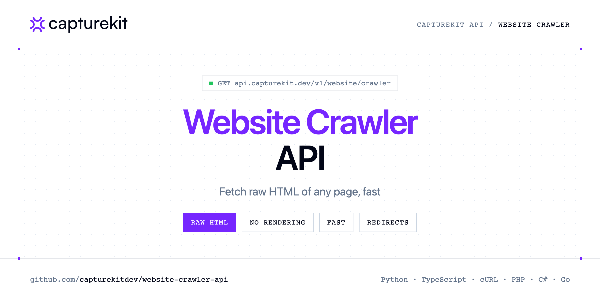

<p align="center">
  <a href="https://www.capturekit.dev"></a>
</p>

# Website Crawler API

[](https://discord.gg/CFj3ph8aHU) [](https://app.capturekit.dev/register) [](https://app.capturekit.dev/openapi) [](LICENSE)

The **CaptureKit Website Crawler API** fetches the raw HTML of a page in request mode (no rendering) — fast and cheap for audits, monitoring and link extraction.

- **Website Crawler API** — Website Crawler API fetches raw HTML from any webpage in request mode (no rendering) for fast scraping, audits, monitoring, and link/metadata extraction.

Use it for SEO crawls, uptime/content monitoring and HTML parsing pipelines.

| Endpoint | Request | Credits |
|---|---|---|
| [Website Crawler API](#website-crawler-api) | `GET /v1/website/crawler` | 1 |

## Table of contents

- [How it works](#how-it-works)
- [Website Crawler API](#website-crawler-api)
- [Code examples in other languages](#code-examples-in-other-languages)
- [Use cases](#use-cases)
- [Why CaptureKit?](#why-capturekit)
- [FAQ](#faq)
- [Related repositories](#related-repositories)
- [Support](#support)

## How it works

1. **Create a CaptureKit account** and copy your API key from the [dashboard](https://app.capturekit.dev/register).
2. **Call `https://api.capturekit.dev`** with the header `x-api-key: YOUR_API_KEY`.
3. **Use the result** in your app — no infrastructure to run.

```bash
export CAPTUREKIT_API_KEY="your-api-key"
pip install requests        # Python
# TypeScript: Node.js 18+ (native fetch), run with `npx tsx file.ts`
```

## Website Crawler API

Website Crawler API fetches raw HTML from any webpage in request mode (no rendering) for fast scraping, audits, monitoring, and link/metadata extraction.

`GET https://api.capturekit.dev/v1/website/crawler` · **1 credit per request** · [API reference](https://app.capturekit.dev/openapi)

### Request parameters

| Parameter | In | Type | Required | Description |
|---|---|---|---|---|
| `query` | query | string | ✅ | A website URL with either the http or https protocol. |
| ` allow_redirects` | query | boolean | — | If set to `false`, do not follow redirects. |
| `return_page_source` | query | boolean | — | If set to `true`, the response will be the HTML source of the page. |

### Python example

```python
import os

import requests

API_KEY = os.environ["CAPTUREKIT_API_KEY"]
HEADERS = {"x-api-key": API_KEY}

response = requests.get(
    "https://api.capturekit.dev/v1/website/crawler",
    headers=HEADERS,
    params={
        "query": "https://github.com/seaweedfs/seaweedfs",
    },
    timeout=120,
)
response.raise_for_status()

print(response.text[:2000])
```

### TypeScript example

```typescript
const headers = { "x-api-key": process.env.CAPTUREKIT_API_KEY!, "Content-Type": "application/json" };

const params = new URLSearchParams({
  "query": "https://github.com/seaweedfs/seaweedfs",
});

const response = await fetch(`https://api.capturekit.dev/v1/website/crawler?${params}`, { headers });
if (!response.ok) throw new Error(`HTTP ${response.status}: ${await response.text()}`);

console.log((await response.text()).slice(0, 2000));
```

### Output

The response body is the raw page content (HTML/text), returned as-is.

## Code examples in other languages

Ready-to-run examples live in [`examples/`](examples); each reads your key from `CAPTUREKIT_API_KEY`.

| Language | `website-crawler` |
|---|---|
| cURL (Bash) | [website_crawler.sh](examples/curl/website_crawler.sh) |
| PHP | [website_crawler.php](examples/php/website_crawler.php) |
| C# | [WebsiteCrawler.cs](examples/csharp/WebsiteCrawler.cs) |
| Go | [website_crawler.go](examples/go/website_crawler.go) |
| Java | [WebsiteCrawlerExample.java](examples/java/WebsiteCrawlerExample.java) |
| Ruby | [website_crawler.rb](examples/ruby/website_crawler.rb) |
| Node.js | [website_crawler.mjs](examples/nodejs/website_crawler.mjs) |

## Use cases

- **SEO crawls** — Fetch HTML of many pages quickly.
- **Monitoring** — Detect content changes on pages.

## Why CaptureKit?

- **Screenshots as a service** — the response body *is* the image or PDF; save it or upload it straight to your S3 bucket.
- **Pixel-perfect options** — full page, viewport size, scale factor, element `selector`, 18 mobile/tablet devices, delays and wait conditions.
- **Clean pages** — remove cookie banners, ads and any CSS selector before capturing.
- **Beyond screenshots** — extract content (metadata, links, HTML, Markdown) or get an AI analysis of any page.
- **Copy-paste examples** — Python and TypeScript in each README, 7 more languages in `examples/`.

## FAQ

### How do I authenticate?

Create an account on [CaptureKit](https://app.capturekit.dev/register), copy your API key and send it in the `x-api-key` header of every request to `https://api.capturekit.dev`.

### How much does a request cost?

Credits per call: `/v1/website/crawler` **1**. See [CaptureKit pricing](https://www.capturekit.dev/pricing).

### Which languages are supported?

Any language that can make an HTTP request. This README shows Python and TypeScript; the [`examples/`](examples) folder contains cURL, PHP, C#, Go, Java, Ruby and Node.js.

## Related repositories

- [Screenshot API](https://github.com/capturekitdev/screenshot-api)
- [Full Page Screenshot API](https://github.com/capturekitdev/full-page-screenshot-api)
- [Website to PDF API](https://github.com/capturekitdev/website-to-pdf-api)
- [Mobile Screenshot API](https://github.com/capturekitdev/mobile-screenshot-api)
- [Website Content API](https://github.com/capturekitdev/website-content-api)
- [AI Website Analyzer API](https://github.com/capturekitdev/ai-website-analyzer-api)
- [All CaptureKit repositories](https://github.com/capturekitdev)

## Support

- 💬 Join the [Discord](https://discord.gg/CFj3ph8aHU) to ask questions and share what you build.
- 📚 Read the [API reference](https://app.capturekit.dev/openapi).
- 🔑 [Get your API key](https://app.capturekit.dev/register).

---

<p align="center">
  <a href="https://www.capturekit.dev">
    <picture>
      <source media="(prefers-color-scheme: dark)" srcset="images/logo-dark.svg">
      
    </picture>
  </a>
  <br>
  <sub>Built by <a href="https://www.capturekit.dev">CaptureKit</a>. Examples are released under the MIT license.</sub>
</p>
